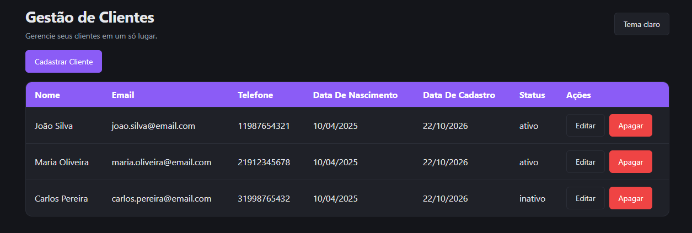

# Sistema de Cadastro de Clientes

Aplicação web para gerenciamento de clientes, desenvolvida como projeto de estudo para praticar desenvolvimento front-end, back-end e integração com banco de dados MySQL.

## Funcionalidades

- Cadastrar novos clientes
- Listar clientes cadastrados
- Editar informações de clientes
- Excluir clientes
- Gerenciar o status dos clientes
- Alternar entre tema claro e escuro
- Interface responsiva

## Tecnologias utilizadas

- HTML5
- CSS3
- JavaScript
- Node.js
- Express
- MySQL
- Git e GitHub

## Como executar o projeto

### 1. Pré-requisitos

Instale os seguintes programas:

- [Node.js](https://nodejs.org/)
- [MySQL](https://dev.mysql.com/downloads/installer/) ou [WampServer](https://www.wampserver.com/)
- [Git](https://git-scm.com/)

### 2. Baixar o projeto

Clone o repositório:

```bash
git clone Substitua https://github.com/danielcamposdossantos797-oss/sistema-de-cadastro-de-clientes.git pelo endereço real do seu repositório no GitHub.
cd sistema-de-cadastro-de-clientes
```

### 3. Instalar as dependências

Dentro da pasta do projeto, execute:

```bash
npm install
```

### 4. Criar o banco de dados

Abra o DBeaver, MySQL Workbench ou outro cliente MySQL e execute o arquivo `banco.sql`.

Esse script cria o banco de dados e a tabela necessários para a aplicação.

### 5. Configurar as variáveis de ambiente

Crie um arquivo `.env` na pasta principal, usando o `.env.example` como modelo.

Configure os dados da sua instalação do MySQL:

```ini
DB_HOST=localhost
DB_USER=seu_usuario
DB_PASSWORD=sua_senha
DB_NAME=cadastro_clientes
PORT=3000
```

Substitua os valores de exemplo pelos dados do seu ambiente. Se o usuário não tiver senha configurada, deixe `DB_PASSWORD=` vazio.

**Importante:** não envie o arquivo `.env` ao GitHub, pois ele contém configurações locais.

### 6. Iniciar o servidor

Execute:

```bash
node server.js
```

Com o servidor funcionando, abra o navegador e acesse:

http://localhost:3000

## Estrutura do projeto

- `server.js` — servidor e rotas da API
- `banco.sql` — script de criação do banco de dados
- `public/` — arquivos HTML, CSS e JavaScript
- `.env.example` — modelo das variáveis de ambiente
- `package.json` — dependências e informações do projeto

## Objetivo do projeto

Projeto de estudo desenvolvido para consolidar conhecimentos em JavaScript, APIs REST, Node.js, Express, MySQL e controle de versão com Git.

## Captura de tela



